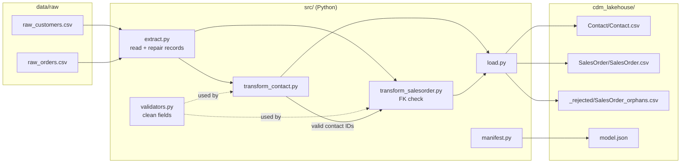
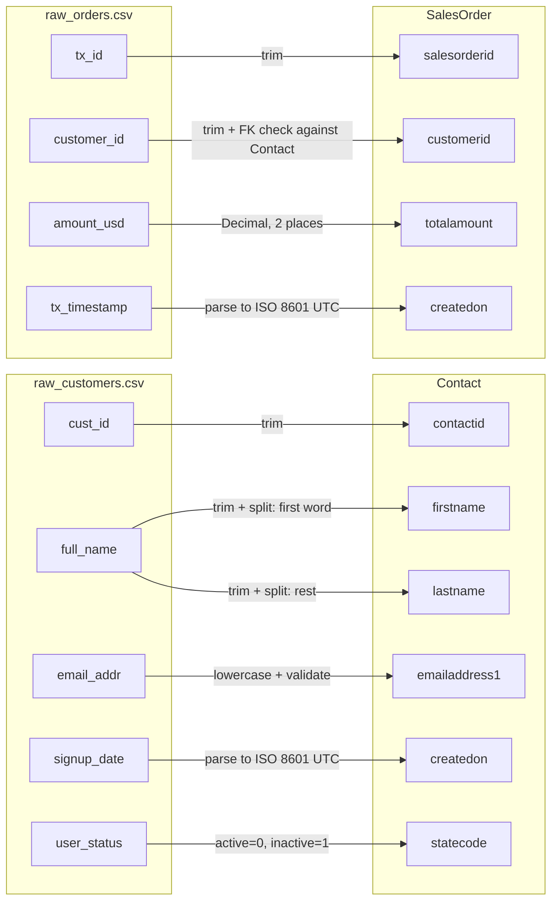
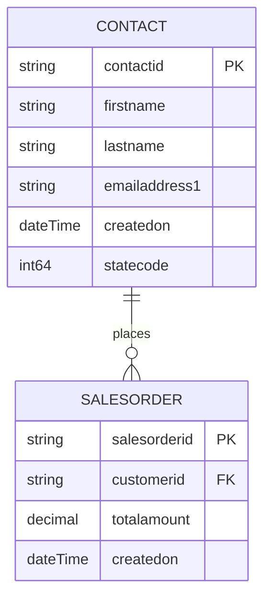
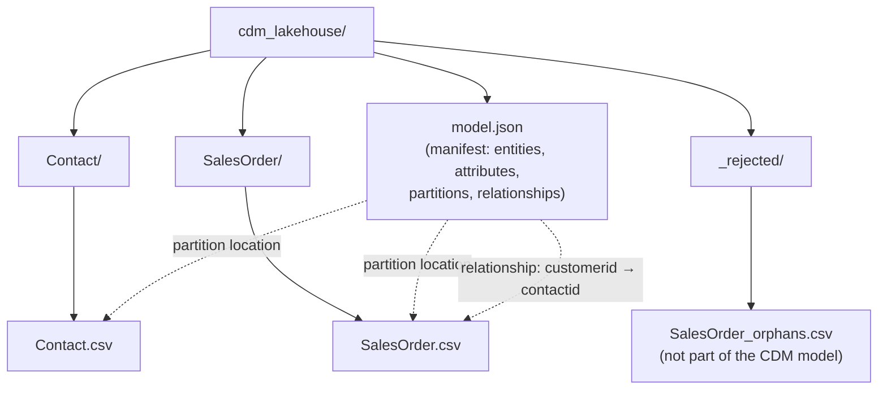

# CDM Ingestion Pipeline

A lightweight Python pipeline that ingests raw customer and order CSV files, cleans and validates them, maps them to **Microsoft Common Data Model (CDM)** entities (`Contact` and `SalesOrder`), and writes them into a CDM folder structure together with a generated `model.json` manifest.

---

## Quick start

Requirements: Python 3.10+

```bash
# 1. Clone and enter the project
git clone https://github.com/<your-user>/reeeliance-cdm-pipeline.git
cd reeeliance-cdm-pipeline

# 2. Create and activate a virtual environment
python -m venv .venv
source .venv/bin/activate        # Windows: .venv\Scripts\activate

# 3. Install dependencies
pip install -r requirements.txt

# 4. Run the pipeline
python -m src.main

# 5. Run the tests
pytest -v
```

The pipeline writes its output to `./cdm_lakehouse/` and a log file to `./logs/pipeline.log`.

---

## Project structure

```
reeeliance-cdm-pipeline/
├── data/raw/                    Raw source files (input)
│   ├── raw_customers.csv
│   └── raw_orders.csv
├── src/
│   ├── config.py                Paths and the CDM schema (single source of truth)
│   ├── extract.py               Robust CSV reading, repairs records split over two lines
│   ├── validators.py            Field-level cleaning: name, email, datetime, statecode
│   ├── transform_contact.py     raw_customers -> CDM Contact
│   ├── transform_salesorder.py  raw_orders -> CDM SalesOrder (+ foreign key check)
│   ├── load.py                  Writes CSV files into the CDM folder structure
│   ├── manifest.py              Generates model.json from the schema in config.py
│   └── main.py                  Pipeline entry point: extract -> transform -> load -> manifest
├── tests/                       Unit and integration tests (pytest)
├── cdm_lakehouse/               Output (CDM folder)
│   ├── Contact/Contact.csv
│   ├── SalesOrder/SalesOrder.csv
│   ├── _rejected/SalesOrder_orphans.csv
│   └── model.json
├── pytest.ini
├── requirements.txt
└── README.md
```

---

## Architecture



---

## 1. Source-to-target mapping



| Source field | Target field | Rule |
| --- | --- | --- |
| `cust_id` | `Contact.contactid` | Trimmed string, must be present and unique (PK) |
| `full_name` | `Contact.firstname`, `Contact.lastname` | Trimmed, first word = first name, rest = last name |
| `email_addr` | `Contact.emailaddress1` | Lowercased; invalid format is logged and set to empty |
| `signup_date` | `Contact.createdon` | Normalized to `YYYY-MM-DDTHH:MM:SSZ` |
| `user_status` | `Contact.statecode` | Case-insensitive: `active` → 0, `inactive` → 1, unknown → empty + log |
| `tx_id` | `SalesOrder.salesorderid` | Trimmed string, must be present and unique (PK) |
| `customer_id` | `SalesOrder.customerid` | Must exist in `Contact.contactid` (FK), otherwise quarantined |
| `amount_usd` | `SalesOrder.totalamount` | `Decimal` with 2 decimal places (no floating-point errors) |
| `tx_timestamp` | `SalesOrder.createdon` | Normalized to `YYYY-MM-DDTHH:MM:SSZ` |

---

## 2. CDM entity relationship



One `Contact` can have zero or many `SalesOrder` records (1:N). Every `SalesOrder.customerid` references exactly one `Contact.contactid`. This relationship is also declared in `model.json` as a `SingleKeyRelationship`.

---

## 3. Storage layout



`model.json` describes each entity, its attributes with data types, and where its data lives (`partitions[].location`). A consumer such as Power BI or Azure Synapse can read the manifest and understand the data without extra documentation.

---

## Design decisions

- **Single source of truth for the schema.** The CDM attributes, data types and descriptions are defined once in `src/config.py`. They drive both the CSV column order and the generated `model.json`, so the files and the manifest cannot drift apart.
- **Log, don't drop silently.** Every data quality issue is logged with the affected record ID. Invalid values become empty instead of crashing the pipeline, and orphan orders are quarantined in `_rejected/` instead of being deleted.
- **Referential integrity.** `SalesOrder.csv` only contains orders whose `customerid` exists in `Contact.csv`.
- **Money as `Decimal`.** Amounts use `Decimal` instead of `float` to avoid rounding errors.
- **Separation of concerns.** Extract only reads and repairs file structure, validators clean single values, transformers map entities, loaders write files.
- **Standard library first.** The pipeline uses only Python's standard library; `pytest` is the only dependency.

---

## Data quality findings in the sample data

| Record | Issue | Handling |
| --- | --- | --- |
| `CST-005` | Record split over two physical lines in the CSV | Lines merged during extraction, logged as warning |
| `CST-005` | Leading whitespace in `full_name` | Trimmed |
| `CST-002` | Email in uppercase | Lowercased |
| `CST-003` | Invalid email `invalid-email-format` | Set to empty, logged as warning |
| `CST-002`, `CST-003` | Non-ISO date formats (`2023-02-20 14:15:00`, `2023-03-05`) | Normalized to ISO 8601 |
| `CST-004` | Status `ACTIVE` in uppercase | Case-insensitive mapping → 0 |
| `ORD-1005` | `customer_id` `CST-999` does not exist | Quarantined in `_rejected/SalesOrder_orphans.csv`, logged as warning |

Result of a run: **5 contacts, 4 sales orders, 1 orphan order quarantined**. Every input record ends up either in the output or in quarantine.

---

## Assumptions

- Timestamps without a timezone are interpreted as **UTC**.
- Dates without a time (`2023-03-05`) are set to **00:00:00**.
- Names are split at the first space: the first word is the first name, the rest is the last name (e.g. `Mary Ann Lee` → `Mary`, `Ann Lee`).
- A record with too few fields is merged with the following line. A record that is still incomplete at the end of the file is logged and dropped.
- Orphan orders are excluded from `SalesOrder.csv` to keep referential integrity, but kept in `_rejected/` so no data is lost.
- Amounts are in USD, as indicated by the source field name.

---

## Tests

```bash
pytest -v
```

31 tests cover:
- **Validators:** all three date formats, email normalization and invalid emails, status mapping, name splitting
- **Extraction:** repair of a record split over two lines, handling of an incomplete last record
- **Transformations:** exact CDM column order, mapping, duplicate IDs, decimal amounts, orphan quarantine
- **Integration:** runs the full pipeline into a temporary folder and checks that all files exist, row counts match the source (no data lost), referential integrity holds, and `model.json` matches the written CSV files

---

## With more time

- **Schema validation** with Pydantic models per entity
- **Parquet** instead of CSV for typed, compressed, columnar storage
- **Incremental loads** with a watermark on `createdon`, and idempotent upserts
- **Partitioning by date** (e.g. `SalesOrder/year=2023/month=06/`) for larger volumes
- **Orchestration** with Airflow or Prefect, including retries and alerting
- **Data quality report** as a machine-readable file (counts per issue type) for monitoring
- **Full CDM compliance check** against the official CDM entity definitions